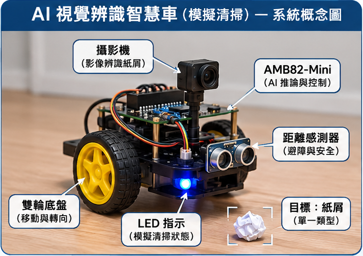
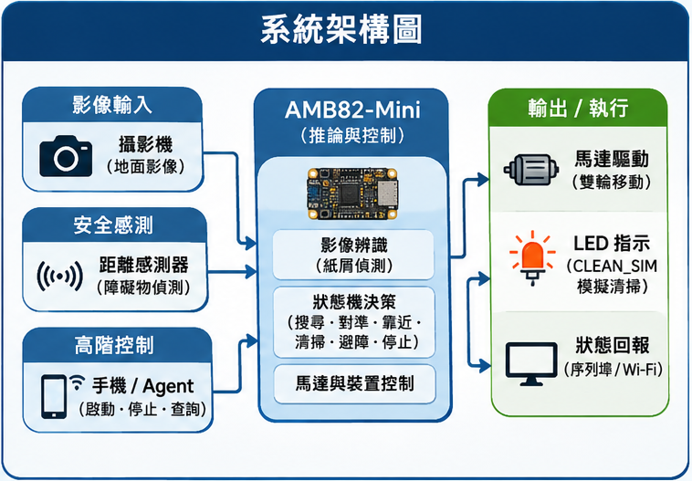
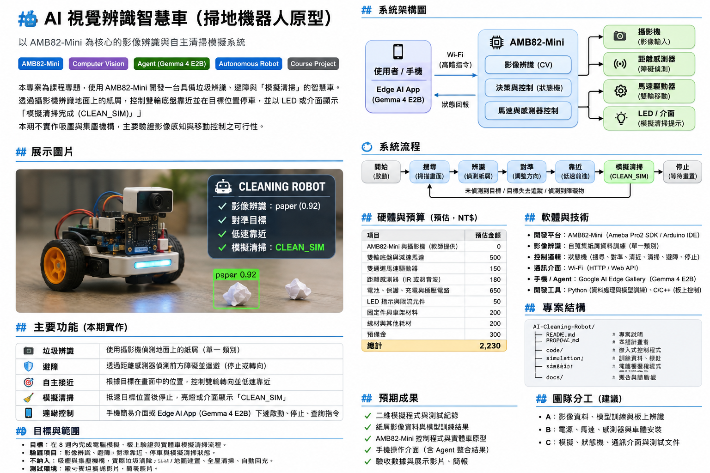

# 🤖 AI 視覺辨識智慧車｜模擬清掃

**AI Vision-Based Smart Car for Simulated Cleaning**

    

> **專題定位：** 以 AMB82-Mini 為核心的實體雙輪智慧車，驗證未來掃地機器人所需要的「紙屑辨識 → 對準 → 靠近 → 避障 → 模擬清掃」流程。**本期不裝吸塵風機、吸嘴或集塵盒，亦不會實際移除垃圾。**
>
> **目前狀態：提案階段。** 本頁描述計畫、預期架構及驗收標準，並非宣稱硬體、辨識模型、AI Agent 或測試指標已完成。

<p align="center">
  
</p>
<p align="center"><sub>AI 合成概念圖，僅供預期外觀參考，非實際完成作品或測試照片；實際使用之感測器及車體配置以組裝後為準。</sub></p>

## 📌 專題簡介

本專題預計使用教師提供的 **AMB82-Mini 與攝影機**，搭配雙輪底盤、距離感測器、馬達驅動器及 LED，製作可在受控室內環境中自動搜尋並接近**單一指定類型紙屑**的智慧車。

開發採三階段：先在電腦端以簡單 **2D 場景模擬**移動與避障，再進行 **AMB82-Mini 板上辨識與決策驗證**，最後整合至**實體智慧車**。車輛抵達預先校正的目標位置後停止，顯示 `CLEAN_SIM` 約 2 秒，代表「模擬清掃完成」；紙屑仍留在地板上。

| 專案資訊 | 規劃內容 |
|---|---|
| 專題類型 | 嵌入式 AI／電腦視覺／機器人自動控制 |
| 開發時間 | 8 週 |
| 團隊人數 | 3 人 |
| 核心控制板 | AMB82-Mini（由教師提供） |
| 測試環境 | 無階差、平坦硬質地板、受控光線 |
| 預估自購材料費 | **NT$2,230**（含預備金，尚未詢價） |
| 材料預算上限 | NT$3,000 |
| 專案進度 | 提案／待實作驗證 |

詳細的研究規劃與驗收方式請參閱 **[PROPOSAL.md](PROPOSAL.md)**。

## ✨ 主要功能

| 功能 | 預定運作方式 | 本期範圍 |
|---|---|---|
| 📷 紙屑影像辨識 | 前置下傾攝影機辨識單一紙屑類別，輸出目標框與信心值 | 核心目標 |
| 🧭 對準與靠近 | 使用目標框中心相對於畫面中心的左右偏差，控制雙輪低速轉向及分段前進 | 核心目標 |
| 🛡️ 障礙物避讓 | 距離感測器檢查前方障礙，遇到危險距離時停止或重新搜尋 | 核心目標 |
| 💡 模擬清掃 | 停在預先校正的目標區域後，以 LED／介面顯示 `CLEAN_SIM` | 核心目標，**不吸取垃圾** |
| 📱 手機基本控制 | 經 Wi-Fi 傳送「開始、停止、查詢狀態」等受限命令 | 基本操作目標 |
| 🧠 AI Agent 互動 | 評估 Google AI Edge Gallery 與 Gemma 4 E2B 串接相容性 | 課程整合目標，**待驗證** |

**本期不包含：** 實體吸塵與集塵、多類垃圾、全屋地圖／SLAM、自動回充、直接語音操作與完整三維物理模擬。上述內容僅作為未來擴充方向。

## 🧩 系統架構



圖中實線表示預定的控制與資料方向；虛線表示模擬規則轉移、模型部署或待驗證的 AI Agent 串接關係。圖示為**設計規劃**，不代表各項連線已完成測試。

### 電腦模擬端

- 在 2D 場景中模擬智慧車、紙屑、障礙物、感測範圍及移動軌跡。
- 在同一套狀態定義下驗證搜尋、對準、靠近、避障及停止的決策邏輯。
- 蒐集紙屑影像並訓練單一類別模型，進行模型轉換及板上載入相容性測試。
- 模擬僅使用虛擬感測器可觀察的資訊，不直接讀取所有場景物件的真實位置。

### AMB82-Mini 智慧車端

- **影像輸入：** 前置下傾攝影機，辨識地面目標。
- **安全輸入：** 距離感測器判斷障礙是否接近；不將其讀值直接視為貼地紙屑距離。
- **本地決策：** 以狀態機執行車輪動作及 `CLEAN_SIM`，安全停止的優先權高於遠端指令。
- **動作輸出：** 經馬達驅動器控制左右輪，以 LED 或介面顯示模擬清掃結果。
- **通訊：** 透過 Wi-Fi 接收受限高階命令並回報狀態；不開放任意 PWM/GPIO 給 AI Agent 操作。

### 手機互動方式比較

| 方式 | 互動範例 | 優點 | 限制／安排 |
|---|---|---|---|
| **A. 手機 Edge AI App** | 「開始清掃」、「停止」、「目前狀態？」 | 適合高階語意命令，車端仍能自行執行安全控制 | 第一週確認 App／模型版本，第二週驗證可行性，第七週嘗試整合 |
| **B. 直接與車子說話** | 對車體麥克風直接下命令 | 操作直覺、不一定需要看手機 | 收音、語音辨識與噪音問題較複雜，**本期列為延伸功能** |

若指定的 Google AI Edge Gallery／Gemma 4 E2B 在課程環境中無法相容，先保留獨立的手機啟停與狀態查詢介面，並向教師確認 Agent 部分的替代驗收方式；**基本手機控制不能視為已完成 Agent 整合**。

## 🔄 模擬清掃流程



1. **SEARCH：** 車輛低速搜尋地面上的指定紙屑。
2. **DETECT：** 確認影像中的紙屑位置及偵測結果。
3. **ALIGN：** 根據目標框偏差調整車頭方向。
4. **APPROACH：** 低速分段前進，以校正的影像位置推估停車點。
5. **CLEAN_SIM：** 抵達預定區域後停止車輪，LED 或介面顯示模擬清掃約 2 秒。
6. **DONE：** 保持停止，等待人工重置車輛及紙屑。

若目標消失、感測資料無效、通訊逾時或距離過近，採取保守停車／避障；不在失去目標後盲目前進。**只有實體車上攝影機與移動控制整合後，才可驗證完整視覺閉迴路。**

## ⚙️ 硬體配置與預算

| 項目 | 說明 | 預估費用（NT$） |
|---|---|---:|
| AMB82-Mini 與攝影機 | 教師提供 | 0 |
| 雙輪底盤與減速馬達 | 智慧車移動 | 500 |
| 雙通道馬達驅動器 | 左右輪控制 | 150 |
| 距離感測器 | 前方障礙物偵測 | 180 |
| 電池、保護、充電與穩壓電路 | 系統電源供應 | 650 |
| LED 指示與限流元件 | `CLEAN_SIM` 狀態表示 | 50 |
| 固定件與車架材料 | 模組固定與安裝 | 200 |
| 線材與其他耗材 | 接線、焊接與備品 | 200 |
| 預備金 | 不可預期耗材 | 300 |
| **合計** | **預估值，尚未實際報價** | **2,230** |

> 材料預算上限為 **NT$3,000**。若教師有提供現成教學車，先確認可沿用的底盤、馬達、驅動器與供電規格後再採購。馬達不得直接由 GPIO 供電，接線前須確認電壓、電流及電池保護條件。

## 🗓️ 八週開發進度

| 週次 | 預定工作 | 當週驗收重點 |
|---|---|---|
| Week 1 | 確認設備與供電、攝影機範例、2D 場景及 Agent 條件 | 設備表、攝影機畫面、虛擬車移動 |
| Week 2 | 完成模擬狀態機與五類場景、蒐集紙屑資料、初測 Agent | 搜尋、左右目標、障礙與停止紀錄 |
| Week 3 | 單一紙屑模型訓練、測試、轉換與板上載入 | 非訓練影像測試、誤判、模型載入紀錄 |
| Week 4 | 板上辨識與動作決策、距離感測及 Wi-Fi 基礎控制 | 方向判斷、推論延遲、停止行為 |
| Week 5 | 安裝控制板、感測器及馬達，先架空後低速落地 | 手動啟停、基本避障、供電穩定 |
| Week 6 | 視覺與車輛整合、校正停車位置、模擬清掃 | 完整的搜尋到 `CLEAN_SIM` 流程 |
| Week 7 | 重複測試、修正、手機與 Agent 整合嘗試 | 測試初表與實際整合完成程度 |
| Week 8 | 正式驗收、整理資料、製作展示影片及簡報 | 原型、程式模型、數據與展示成果 |

## 📊 預定驗收指標

以下為**專題預定目標，並非測試結果**。實測前需固定紙屑外觀、地板、光線、初始位置、停止區域、測試時限，並保留失敗紀錄。

| 項目 | 測試方式 | 預定目標 |
|---|---|---|
| 2D 模擬控制 | 五類情境與狀態轉移紀錄 | 全部符合預期 |
| 紙屑辨識 | 至少 20 次獨立目標呈現，另記錄無垃圾場景誤報 | 正確偵測比例 ≥ 80% |
| 障礙安全處理 | 20 次障礙接近試驗 | 至少 18 次無碰撞停止／轉向 |
| 對準及模擬清掃 | 20 次試驗，車體不碰觸紙屑並停於標定區域 | 至少 14 次完成 `CLEAN_SIM` |
| 異常安全停止 | 啟停、通訊中斷、目標消失、無效感測資料 | 能進入預定保守停止狀態 |
| 期末整合展示 | 單一紙屑與一處障礙物的受控場地 | 展示辨識、靠近／避障、停車及狀態回報 |

## 👥 專題組員與團隊分工

### 組員名單

| 班級 | 學號 | 姓名 |
|---|---|---|
| 電機3A | 01353016 | 陳畇辰 |
| 電機3A | 01353020 | 劉倢睿 |
| 電機3A | 01353040 | 邱瀚祺 |

### 分工建議（實際負責人由組內確認）

| 工作角色 | 預定負責內容 |
|---|---|
| A | 影像資料、模型訓練與 AMB82-Mini 影像 |
| B | 電源、馬達、距離感測及車體安裝 |
| C | 2D 模擬、狀態機、通訊、測試與文件 |

> 以上為三人團隊的建議工作分配，尚未指定各角色對應的組員。

## 📁 專案檔案結構

目前應先上傳 `README.md`、`PROPOSAL.md` 及 `assets/` 圖片；其餘資料夾是**後續開發建議結構**，不表示程式或模型已存在。

```text
AI-Vision-Smart-Car/
├── README.md                       # GitHub 專題首頁
├── PROPOSAL.md                     # 八週計畫書
├── assets/
│   ├── smart-car-concept.png       # AI 合成智慧車概念圖
│   ├── system-architecture.png     # 系統架構圖
│   └── cleaning-workflow.png       # 模擬清掃流程圖
├── simulation/                     # 待建立：二維模擬程式
├── firmware/                       # 待建立：AMB82-Mini 控制程式
├── model/                          # 待建立：訓練模型／部署紀錄
├── data/                           # 待建立：紙屑影像及標註資料
└── docs/                           # 待建立：測試紀錄、報告與展示
```

## 🎬 預定成果與展示情境

在受控室內測試區放置**一處障礙與一片指定紙屑**，啟動智慧車後，預期可展示：搜尋目標 → 辨識紙屑 → 安全避障／調整車頭 → 低速接近 → 停於校正區域 → 顯示 `CLEAN_SIM` → 停止等待重置。

預定交付項目包括：二維模擬程式、紙屑資料與模型、AMB82-Mini 控制程式、實體智慧車、手機基本控制介面、測試報告與展示影片。所有結果將區分為 **模擬、板上測試、實車測試、Agent 整合** 四種狀態，並如實註明尚未完成之功能。

## 🔭 未來擴充

完成八週核心驗證後，可視後續時間與成本，另行評估吸塵風機、吸嘴與集塵盒、多類垃圾辨識、直接語音控制、室內地圖建立，以及自動回充。這些功能**不屬於本次八週驗收**。

## 📚 參考資料

- [本專題完整八週計畫書](PROPOSAL.md)
- [教師範例：AI-plush-giraffe](https://github.com/rkuo2000/AI-plush-giraffe)
- [教師範例 PROPOSAL.md](https://github.com/rkuo2000/AI-plush-giraffe/blob/629b5f16c601f84f09c4512d38ce4460e157a3da/PROPOSAL.md)
- [教師範例 README.md](https://github.com/rkuo2000/AI-plush-giraffe/blob/629b5f16c601f84f09c4512d38ce4460e157a3da/README.md)

---

**註：** 本 README 與概念圖用於課程計畫展示；所有功能與效能數據在完成實作及驗收以前均屬規劃，非已驗證成果。
